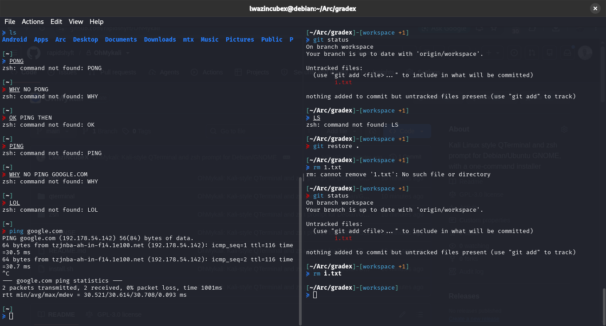

# OhMykali

The Kali Linux terminal look on Debian or Ubuntu with GNOME: QTerminal with split panes, Kali's dark theme and a clean two-line zsh prompt that shows your git status.



```
[~/Arc/gradex]-[workspace +2 ↑1 ↓3]
≽ git status
```

## Install

```bash
git clone https://github.com/rapidshyft/OhMykali.git
cd OhMykali
./install.sh
```

Run it as your normal user, not with `sudo`. It asks for your password when it installs packages and changes your shell. You can run it again at any time, for example after pulling updates. It only changes what isn't already set up.

`./install.sh --skip-packages` applies the configs without touching apt.

## Disclaimer

Use at your own risk. The installer installs packages, changes your login shell and edits `~/.zshrc` (with a backup each time). Read `install.sh` before you run it. OhMykali comes with no warranty, see sections 15–16 of the [LICENSE](LICENSE).

## What it sets up

| Part | What you get |
|---|---|
| Packages | `zsh`, `git`, `qterminal`, `qt6ct` (or `qt5ct` on older releases), `fonts-firacode`, `zsh-syntax-highlighting`, `zsh-autosuggestions` |
| QTerminal | Kali-Dark colours, Fira Code 10, slight transparency, tab bar hidden with one tab |
| Split panes | `Ctrl+Shift+R` side by side, `Ctrl+Shift+D` top and bottom, `Ctrl+Shift+E` close the split |
| Dark menus and title bar | Kali's Qt theme through qt6ct, applied to QTerminal only |
| Shortcut | `Ctrl+Alt+T` opens QTerminal (GNOME) |
| Prompt | Path, git branch and status, `≽` turns red after a failed command. `Ctrl+P` toggles a one-line prompt |
| Highlighting | Commands coloured as you type, with Kali's colours, plus grey suggestions from your history |
| Powerlevel10k | Turned off if present (left installed). `uninstall.sh` turns it back on |
| Shell | Switches your login shell to zsh |

### Prompt colours

| Mark | Colour | Meaning |
|---|---|---|
| `+N` | yellow | files with uncommitted changes |
| `↑N` | green | commits ready to push |
| `↓N` | magenta | commits ready to pull, as of your last `git fetch` |

### Works with or without Oh My Zsh

If your `~/.zshrc` loads Oh My Zsh, OhMykali only replaces the prompt and highlight colours and keeps your Oh My Zsh settings. Without Oh My Zsh it also applies Kali's shell defaults: history, tab-completion menu, `Ctrl+arrow` word jumps, coloured `ls`, `ll`/`la` aliases.

## Files it touches

- `~/.zshrc`: Powerlevel10k lines are commented with a `#ohmykali#` tag, and one `source` line is added at the end. A backup is saved as `~/.zshrc.ohmykali-<date>.bak` on every change
- `~/.config/ohmykali/ohmykali.zsh`: the prompt and highlighting
- `~/.config/qterminal.org/`: QTerminal settings (merged, backup kept) and the Kali colour schemes
- `~/.config/qt6ct/` (or `qt5ct`): Kali Qt theme
- `~/.local/share/applications/qterminal.desktop`: starts QTerminal with the Kali theme

Close QTerminal before installing. It saves its settings when it exits and can overwrite the new ones.

## Uninstall

```bash
./uninstall.sh
```

Restores your `~/.zshrc` (Powerlevel10k included), removes the configs and the shortcut. Packages and your login shell stay as they are.

## Customise

Edit `zsh/ohmykali.zsh` and run `./install.sh` again. The top of the file sets the defaults:

```zsh
PROMPT_ALTERNATIVE=twoline   # or oneline
NEWLINE_BEFORE_PROMPT=yes    # blank line between commands
```

## Credits and licence

The QTerminal colour schemes and Qt theme come from Kali's [kali-themes](https://gitlab.com/kalilinux/packages/kali-themes) package (GPL-3.0+). The shell defaults and highlight colours come from Kali's [kali-defaults](https://gitlab.com/kalilinux/packages/kali-defaults) package (GPL-2.0+). OhMykali is released under the GPL-3.0, see [LICENSE](LICENSE).

This isn't an official Kali Linux project. Kali Linux is a trademark of OffSec.
